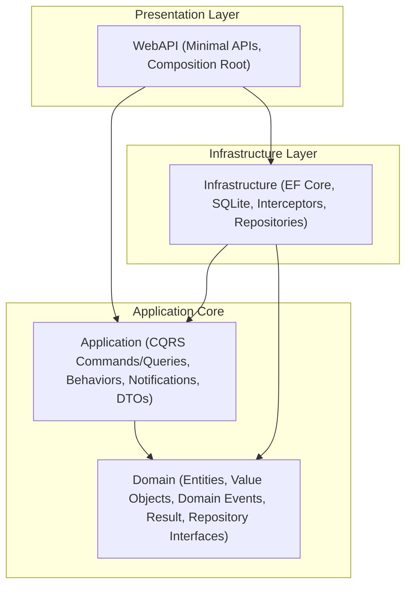
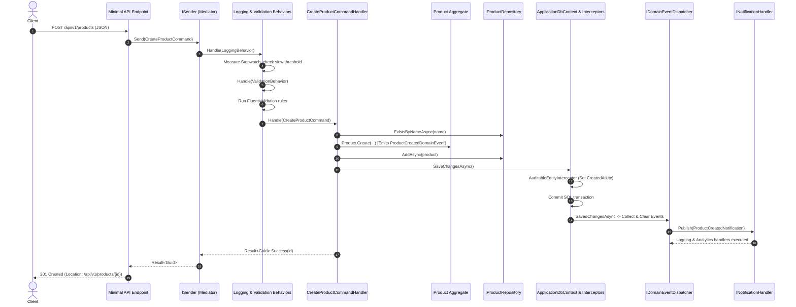

# Clean Architecture Mediator Showcase (.NET 10 & C# 14)

[](https://github.com/owner/CleanArchitectureMediatorShowcase/actions/workflows/ci.yml)
[](LICENSE)
[-purple.svg)](https://dotnet.microsoft.com/)
[](https://learn.microsoft.com/dotnet/csharp/)
[-green.svg)](https://github.com/martinothamar/Mediator)

> **The gold-standard, production-quality, interview-ready reference implementation of Clean Architecture on .NET 10 (`net10.0`, LTS) and C# 14**, featuring a deliberately trivial **Product Catalog CRUD** domain powered by the MIT-licensed compile-time source generator mediator: **[martinothamar/Mediator](https://github.com/martinothamar/Mediator)**.

---

## Table of Contents
1. [Core Objective](#core-objective)
2. [Quickstart](#quickstart)
3. [Architecture Overview & Layer Diagrams](#architecture-overview--layer-diagrams)
4. [Layer-by-Layer Architectural Guide](#layer-by-layer-architectural-guide)
5. [Design Patterns Reference Table](#design-patterns-reference-table)
6. [SOLID Principles Implementation](#solid-principles-implementation)
7. [End-to-End Request Lifecycle](#end-to-end-request-lifecycle)
8. [How to Inspect the Generated Mediator Code](#how-to-inspect-the-generated-mediator-code)
9. [Why martinothamar/Mediator Over Alternatives](#why-martinothamarmediator-over-alternatives)
10. [Comparison: Library Mediator vs Hand-Written Dispatcher](#comparison-library-mediator-vs-hand-written-dispatcher)
11. [Architectural Debates & Pragmatic Realities](#architectural-debates--pragmatic-realities)
12. [Intentional Scoping & Known Limitations](#intentional-scoping--known-limitations)
13. [Verification & Test Results](#verification--test-results)

---

## Core Objective

The business domain in this repository is intentionally trivial: a **Product Catalog** with basic CRUD operations and inventory stock adjustments. 

By keeping the domain simple, all architectural focus remains on:
- **Clean Architecture** layer boundaries and strict dependency rules.
- **SOLID principles** applied practically without academic bloat.
- **Modern .NET 10 & C# 14 idioms**: `global.json` with Microsoft.Testing.Platform runner, C# 14 language constructs, Central Package Management (`Directory.Packages.props`), and `.slnx` solution format.
- **Compile-Time Mediator (`martinothamar/Mediator`)**: A 100% MIT-licensed, Native AOT-ready, `ValueTask`-based alternative to MediatR that replaces runtime reflection with compile-time Roslyn source generation.
- **Production-Grade Testing**: 76 automated tests across Unit, Integration (isolated SQLite per test), and Architecture test suites.

A sibling repository (`clean-architecture-cqrs-from-scratch`) implements the exact same domain with a hand-written dispatcher. This showcase serves as the authoritative reference for using an open-source mediator library **the right way** within Clean Architecture.

---

## Quickstart

### Prerequisites
- [.NET 10 SDK](https://dotnet.microsoft.com/download/dotnet/10.0) (`10.0.403` or later)
- Git

### 1. Clone & Restore
```bash
git clone https://github.com/owner/CleanArchitectureMediatorShowcase.git
cd CleanArchitectureMediatorShowcase
dotnet restore
```

### 2. Run the Web API
```bash
dotnet run --project src/CleanArchitectureMediatorShowcase.WebAPI
```

### 3. Explore Interactive API Documentation
Open your browser to:
- **Scalar API Reference**: [http://localhost:5000/scalar](http://localhost:5000/scalar)
- **OpenAPI v3 JSON**: [http://localhost:5000/openapi/v1.json](http://localhost:5000/openapi/v1.json)
- **Liveness Health Check**: [http://localhost:5000/health](http://localhost:5000/health)
- **Readiness Health Check (DB connectivity)**: [http://localhost:5000/health/ready](http://localhost:5000/health/ready)

### 4. Run Automated Tests
```bash
dotnet test CleanArchitectureMediatorShowcase.slnx -c Release
```
*(Executes all 76 unit, integration, and architecture tests in seconds via Microsoft.Testing.Platform)*.

---

## Architecture Overview & Layer Diagrams

Clean Architecture enforces the **Dependency Rule**: *dependencies only point inward*. Inner layers know nothing about outer layers.



### Component & Flow Topology


---

## Layer-by-Layer Architectural Guide

| Layer | Responsibility | Dependencies Allowed | Strictly Forbidden |
| :--- | :--- | :--- | :--- |
| **`Domain`** | Enterprise business rules, entities, domain events, result types, repository interfaces | **ZERO dependencies** (pure C# BCL only) | Any NuGet package, `Mediator.Abstractions`, EF Core, FluentValidation, Web packages |
| **`Application`** | Use case orchestration, CQRS command/query handlers, pipeline behaviors, event dispatcher, DTOs | `Domain`, `Mediator.Abstractions`, FluentValidation, Microsoft.Extensions Abstractions, Riok.Mapperly | Direct database access, EF Core, Infrastructure, WebAPI, HTTP abstractions |
| **`Infrastructure`** | Persistence implementation, EF Core DbContext, migrations, repositories, audit/event interceptors | `Domain`, `Application`, EF Core SQLite, EF Core Design, Health Checks | WebAPI, presentation controllers/endpoints |
| **`WebAPI`** | Composition root, Minimal API routing, Swagger/Scalar, RFC 9457 error formatting | `Application`, `Infrastructure`, `Mediator.SourceGenerator`, Built-in OpenAPI, Scalar | Business logic, direct DB queries, throwing unhandled exceptions |

---

## Design Patterns Reference Table

Every design pattern in this codebase serves a distinct architectural purpose:

| Pattern | Architectural Role | Concrete Implementation File(s) |
| :--- | :--- | :--- |
| **CQRS** | Segregates write mutations from read-only projections | Commands in [`CreateProductCommand.cs`](file:///d:/Projects/Code/ant/CleanArchitectureMediatorShowcase/src/CleanArchitectureMediatorShowcase.Application/Features/Products/CreateProduct/CreateProductCommand.cs), Queries in [`GetProductsQuery.cs`](file:///d:/Projects/Code/ant/CleanArchitectureMediatorShowcase/src/CleanArchitectureMediatorShowcase.Application/Features/Products/GetProducts/GetProductsQuery.cs) |
| **Mediator** | Decouples senders of requests from concrete handlers at compile-time | [`Mediator.Abstractions`](file:///d:/Projects/Code/ant/CleanArchitectureMediatorShowcase/src/CleanArchitectureMediatorShowcase.Application) & generated [`Mediator.g.cs`](file:///d:/Projects/Code/ant/CleanArchitectureMediatorShowcase/src/CleanArchitectureMediatorShowcase.WebAPI/Generated/Mediator.SourceGenerator/Mediator.SourceGenerator.IncrementalMediatorGenerator/Mediator.g.cs) |
| **Pipeline / Decorator** | Injects cross-cutting concerns (logging, validation) around handler execution | [`LoggingBehavior.cs`](file:///d:/Projects/Code/ant/CleanArchitectureMediatorShowcase/src/CleanArchitectureMediatorShowcase.Application/Common/Behaviors/LoggingBehavior.cs), [`ValidationBehavior.cs`](file:///d:/Projects/Code/ant/CleanArchitectureMediatorShowcase/src/CleanArchitectureMediatorShowcase.Application/Common/Behaviors/ValidationBehavior.cs) |
| **Chain of Responsibility** | Sequences open generic pipeline behaviors in deterministic outer-to-inner order | Configured in [`Program.cs`](file:///d:/Projects/Code/ant/CleanArchitectureMediatorShowcase/src/CleanArchitectureMediatorShowcase.WebAPI/Program.cs#L22-L28), tested in [`PipelineExecutionOrderTests.cs`](file:///d:/Projects/Code/ant/CleanArchitectureMediatorShowcase/tests/CleanArchitectureMediatorShowcase.UnitTests/Application/PipelineExecutionOrderTests.cs) |
| **Repository** | Mediates between domain and data mapping layers | Write: [`ProductRepository.cs`](file:///d:/Projects/Code/ant/CleanArchitectureMediatorShowcase/src/CleanArchitectureMediatorShowcase.Infrastructure/Repositories/ProductRepository.cs), Read: [`ProductReadRepository.cs`](file:///d:/Projects/Code/ant/CleanArchitectureMediatorShowcase/src/CleanArchitectureMediatorShowcase.Infrastructure/Repositories/ProductReadRepository.cs) |
| **Unit of Work** | Maintains transactional consistency across multiple repository operations | [`IUnitOfWork.cs`](file:///d:/Projects/Code/ant/CleanArchitectureMediatorShowcase/src/CleanArchitectureMediatorShowcase.Domain/Abstractions/IUnitOfWork.cs) implemented by [`ApplicationDbContext.cs`](file:///d:/Projects/Code/ant/CleanArchitectureMediatorShowcase/src/CleanArchitectureMediatorShowcase.Infrastructure/ApplicationDbContext.cs) |
| **Result Pattern** | Replaces exceptions with explicit, typed return values for expected domain failures | [`Result.cs`](file:///d:/Projects/Code/ant/CleanArchitectureMediatorShowcase/src/CleanArchitectureMediatorShowcase.Domain/Common/Result.cs), [`Error.cs`](file:///d:/Projects/Code/ant/CleanArchitectureMediatorShowcase/src/CleanArchitectureMediatorShowcase.Domain/Common/Error.cs), [`IFailureResult.cs`](file:///d:/Projects/Code/ant/CleanArchitectureMediatorShowcase/src/CleanArchitectureMediatorShowcase.Domain/Common/IFailureResult.cs) |
| **Static Factory Method** | Encapsulates aggregate invariant validation and identity generation (UUIDv7) | [`Product.Create(...)`](file:///d:/Projects/Code/ant/CleanArchitectureMediatorShowcase/src/CleanArchitectureMediatorShowcase.Domain/Entities/Product.cs#L82) |
| **Interceptor** | Automatically updates audit timestamps and dispatches post-commit domain events | [`AuditableEntityInterceptor.cs`](file:///d:/Projects/Code/ant/CleanArchitectureMediatorShowcase/src/CleanArchitectureMediatorShowcase.Infrastructure/Interceptors/AuditableEntityInterceptor.cs), [`DispatchDomainEventsInterceptor.cs`](file:///d:/Projects/Code/ant/CleanArchitectureMediatorShowcase/src/CleanArchitectureMediatorShowcase.Infrastructure/Interceptors/DispatchDomainEventsInterceptor.cs) |
| **Observer / Notification** | Decouples aggregate creation from secondary side-effects (audit, analytics) | [`ProductCreatedNotification.cs`](file:///d:/Projects/Code/ant/CleanArchitectureMediatorShowcase/src/CleanArchitectureMediatorShowcase.Application/Features/Products/Notifications/ProductCreatedNotification.cs), handled by multiple [`INotificationHandler`](file:///d:/Projects/Code/ant/CleanArchitectureMediatorShowcase/src/CleanArchitectureMediatorShowcase.Application/Features/Products/Notifications/) |
| **Options Pattern** | Strongly typed, hierarchical configuration binding | [`LoggingBehaviorOptions.cs`](file:///d:/Projects/Code/ant/CleanArchitectureMediatorShowcase/src/CleanArchitectureMediatorShowcase.Application/Common/Options/LoggingBehaviorOptions.cs) bound in [`DependencyInjection.cs`](file:///d:/Projects/Code/ant/CleanArchitectureMediatorShowcase/src/CleanArchitectureMediatorShowcase.Application/DependencyInjection.cs) |

---

## SOLID Principles Implementation

| Principle | Meaning in Clean Architecture | Concrete Code Example |
| :--- | :--- | :--- |
| **S** - Single Responsibility | Each class has one reason to change | Handlers handle use cases ([`CreateProductCommandHandler.cs`](file:///d:/Projects/Code/ant/CleanArchitectureMediatorShowcase/src/CleanArchitectureMediatorShowcase.Application/Features/Products/CreateProduct/CreateProductCommandHandler.cs)); validators only validate ([`CreateProductCommandValidator.cs`](file:///d:/Projects/Code/ant/CleanArchitectureMediatorShowcase/src/CleanArchitectureMediatorShowcase.Application/Features/Products/CreateProduct/CreateProductCommandValidator.cs)). |
| **O** - Open/Closed | Software entities open for extension, closed for modification | Adding a third subscriber to `ProductCreatedNotification` requires zero changes to existing notification handlers or the domain entity. |
| **L** - Liskov Substitution | Subtypes must be substitutable for their base types | `Result<T>` inherits `Result` and adheres strictly to the success/failure invariants defined on the base type. |
| **I** - Interface Segregation | Clients should not depend on interfaces they do not use | WebAPI endpoints inject [`ISender`](file:///d:/Projects/Code/ant/CleanArchitectureMediatorShowcase/src/CleanArchitectureMediatorShowcase.WebAPI/Endpoints/ProductEndpoints.cs) (send-only commands/queries), never the full `IMediator` which includes publisher capabilities. |
| **D** - Dependency Inversion | High-level modules depend on abstractions, not details | Application depends on [`IProductRepository`](file:///d:/Projects/Code/ant/CleanArchitectureMediatorShowcase/src/CleanArchitectureMediatorShowcase.Domain/Abstractions/IProductRepository.cs) defined in Domain; the concrete EF Core implementation resides in Infrastructure. |

---

## End-to-End Request Lifecycle

When a client sends `POST /api/v1/products`:
1. **HTTP Routing & Model Binding**: Minimal API endpoint in [`ProductEndpoints.cs`](file:///d:/Projects/Code/ant/CleanArchitectureMediatorShowcase/src/CleanArchitectureMediatorShowcase.WebAPI/Endpoints/ProductEndpoints.cs) binds JSON body to `CreateProductRequest`.
2. **Command Instantiation**: Maps request to `CreateProductCommand`.
3. **Mediator Dispatch**: `ISender.Send(command)` invokes the source-generated dispatcher in [`Mediator.g.cs`](file:///d:/Projects/Code/ant/CleanArchitectureMediatorShowcase/src/CleanArchitectureMediatorShowcase.WebAPI/Generated/Mediator.SourceGenerator/Mediator.SourceGenerator.IncrementalMediatorGenerator/Mediator.g.cs).
4. **Logging Behavior (Outermost)**: [`LoggingBehavior.cs`](file:///d:/Projects/Code/ant/CleanArchitectureMediatorShowcase/src/CleanArchitectureMediatorShowcase.Application/Common/Behaviors/LoggingBehavior.cs) logs entry and starts a `Stopwatch`.
5. **Validation Behavior (Innermost)**: [`ValidationBehavior.cs`](file:///d:/Projects/Code/ant/CleanArchitectureMediatorShowcase/src/CleanArchitectureMediatorShowcase.Application/Common/Behaviors/ValidationBehavior.cs) executes [`CreateProductCommandValidator.cs`](file:///d:/Projects/Code/ant/CleanArchitectureMediatorShowcase/src/CleanArchitectureMediatorShowcase.Application/Features/Products/CreateProduct/CreateProductCommandValidator.cs). If validation fails, it short-circuits and returns a `ValidationError` using `TResponse.CreateFailure(error)` without exceptions.
6. **Command Handler Execution**: [`CreateProductCommandHandler.cs`](file:///d:/Projects/Code/ant/CleanArchitectureMediatorShowcase/src/CleanArchitectureMediatorShowcase.Application/Features/Products/CreateProduct/CreateProductCommandHandler.cs) checks for duplicate names via `IProductRepository.ExistsByNameAsync()`.
7. **Domain Factory & Invariant Enforcement**: [`Product.Create(...)`](file:///d:/Projects/Code/ant/CleanArchitectureMediatorShowcase/src/CleanArchitectureMediatorShowcase.Domain/Entities/Product.cs) generates UUIDv7 (`Guid.CreateVersion7()`), validates name/price/stock rules, and queues a `ProductCreatedDomainEvent`.
8. **Unit of Work Commit**: `unitOfWork.SaveChangesAsync()` persists the record to SQLite.
9. **Interceptors Execution**:
   - `AuditableEntityInterceptor` sets `CreatedAtUtc` via `TimeProvider`.
   - SQLite commit executes atomically.
   - `DispatchDomainEventsInterceptor` runs post-commit: drains queued events and delegates to `MediatorDomainEventDispatcher`.
10. **Notification Handling**: Two independent notification handlers (`Logging` and `Analytics`) execute sequentially via `ForeachAwaitPublisher`.
11. **HTTP Result Mapping**: Endpoint returns `TypedResults.Created($"/api/v1/products/{id}", new { id })`.

---

## How to Inspect the Generated Mediator Code

In `CleanArchitectureMediatorShowcase.WebAPI.csproj`, we configured Roslyn to emit source generator files to disk:
```xml
<PropertyGroup>
  <EmitCompilerGeneratedFiles>true</EmitCompilerGeneratedFiles>
  <CompilerGeneratedFilesOutputPath>Generated</CompilerGeneratedFilesOutputPath>
</PropertyGroup>
<ItemGroup>
  <!-- Prevent disk files from being included twice during compilation -->
  <Compile Remove="$(CompilerGeneratedFilesOutputPath)\**" />
</ItemGroup>
```

After building the project, navigate to:
```
src/CleanArchitectureMediatorShowcase.WebAPI/Generated/Mediator.SourceGenerator/Mediator.SourceGenerator.IncrementalMediatorGenerator/
├── AssemblyReference.g.cs
├── Mediator.g.cs                  <-- Complete strongly-typed dispatcher
├── MediatorOptions.g.cs           <-- Options model
└── MediatorOptionsAttribute.g.cs  <-- Assembly-level options attribute
```

Open `Mediator.g.cs` in Visual Studio, Rider, or VS Code. Notice:
- There is **zero reflection** (`System.Reflection` is not used).
- Request handlers are wrapped in strongly typed generic wrappers (`RequestHandlerWrapper<TRequest, TResponse>`).
- Pipeline behaviors are chained using a simple backwards `for` loop, ensuring zero runtime dynamic allocation.

---

## Why martinothamar/Mediator Over Alternatives

A comprehensive, factual comparison of the in-process mediator ecosystem for .NET:

| Library | NuGet Version | License | Dispatch Mechanism | Async Return | Native AOT Friendly | Architectural Fit |
| :--- | :--- | :--- | :--- | :--- | :--- | :--- |
| **`martinothamar/Mediator`** | **`3.0.2`** | **MIT** | **Compile-time Roslyn Source Generator** | `ValueTask` | **Yes (100%)** | **Gold Standard** (clean abstraction separation, high performance) |
| **`MediatR`** | `14.2.0` | **RPL-1.5 / Commercial** | Runtime reflection & cached delegates | `Task` | Partial / warnings | Commercial legal complexity; community edition has constraints |
| **`MediatR (Legacy)`** | `12.4.2` | Apache-2.0 | Runtime reflection & compiled expressions | `Task` | Poor | Feature-frozen by author; legacy reflection architecture |
| **`LiteBus`** | `6.0.2` | MIT | Runtime descriptor registry | `Task` / `ValueTask` | Partial | Good alternative, but uses runtime service discovery |
| **`Wolverine`** | `6.54.0` | Apache-2.0 | Runtime Roslyn code generation & dynamic compilation | Dynamic | No | Full messaging platform / service bus; heavy for in-process CQRS |
| **`Cortex.Mediator`** | `1.x` | MIT | Runtime service resolution | `Task` | Partial | Lacks the maturity and compile-time guarantees of Roslyn generation |

---

## Comparison: Library Mediator vs Hand-Written Dispatcher

Our sibling repository (`clean-architecture-cqrs-from-scratch`) implements this exact Product domain using a hand-written `IDispatcher` and custom `ICommandHandler` / `IQueryHandler` interfaces without any third-party mediator library.

Here is an honest, qualitative architectural comparison:

| Dimension | `martinothamar/Mediator` (This Repo) | Hand-Written Dispatcher (`from-scratch`) |
| :--- | :--- | :--- |
| **External Dependencies** | Depends on `Mediator.Abstractions` (Application) and `Mediator.SourceGenerator` (WebAPI). | **Zero external dependencies** across all layers. |
| **Licensing** | Permissive MIT license (safe for commercial use). | Fully owned in-house code (zero licensing concerns). |
| **Execution Mechanics** | Compile-time Roslyn source generator generates dispatcher classes. | Direct C# dispatch via DI service provider resolution or dictionary lookup. |
| **Async Return Type** | Uses `ValueTask` / `ValueTask<T>` (allocation-free for synchronous completions). | Typically `Task` / `Task<T>`, unless custom `ValueTask` is authored. |
| **Native AOT Readiness** | **Native AOT Ready** by design; emits static direct calls. | **Native AOT Ready** if written without reflection. |
| **Debugging & F12 Experience** | Pressing F12 on `Send()` navigates to generated mediator code or interface; locating handler requires searching references. | Pressing F12 navigates directly to your hand-written dispatcher implementation. |
| **Maintenance Burden** | Offloaded to open-source maintainer; library updates may change option names. | Maintained entirely by internal team; zero external breaking changes. |
| **Cross-Cutting Pipelines** | Supported out-of-the-box via `IPipelineBehavior<TMessage, TResponse>` with generic constraints. | Requires writing custom decorator chain or pipeline runner. |
| **When to Choose** | Multi-team enterprise codebases needing standardized CQRS conventions, pipeline behaviors, and streaming handlers. | Microservices, libraries, or ultra-lean codebases where zero external dependencies and absolute simplicity are paramount. |

---

## Architectural Debates & Pragmatic Realities

### 1. Is Clean Architecture Overkill for CRUD?
**Yes, absolutely.** If your application is a straightforward CRUD application that will never have complex domain invariants, Clean Architecture introduces unnecessary indirection (7 projects, mapping layers, repository abstractions). 
- For simple CRUD, **Vertical Slice Architecture** with Minimal APIs and EF Core `DbContext` injected directly into endpoints is often faster to ship and easier to maintain.
- We deliberately chose a trivial Product CRUD domain for this showcase so you can study the architecture and conventions without getting lost in complicated business logic.

### 2. The Repository Pattern Over EF Core Debate
Critics argue: *"EF Core's `DbSet` is already a repository, and `DbContext` is already a Unit of Work. Wrapping them is redundant."*
- **Our pragmatic resolution**:
  - We do **not** write generic `IRepository<T>` antipatterns with 50 leaky LINQ methods.
  - The write repository ([`IProductRepository.cs`](file:///d:/Projects/Code/ant/CleanArchitectureMediatorShowcase/src/CleanArchitectureMediatorShowcase.Domain/Abstractions/IProductRepository.cs)) defines only the explicit domain operations required to mutate the aggregate root (`GetByIdAsync`, `AddAsync`, `Remove`, `ExistsByNameAsync`).
  - Queries bypass the aggregate root entirely via a read-optimized abstraction ([`IProductReadRepository.cs`](file:///d:/Projects/Code/ant/CleanArchitectureMediatorShowcase/src/CleanArchitectureMediatorShowcase.Application/Features/Products/Common/IProductReadRepository.cs)) that executes direct `AsNoTracking()` SQL projections via Mapperly.

---

## Intentional Scoping & Known Limitations

To maintain uncompromising scope discipline, the following enterprise capabilities were intentionally omitted:
1. **Authentication & Authorization**: No JWT or ASP.NET Identity. Endpoints are public.
2. **Transactional Outbox Pattern**: In-memory domain event dispatching occurs post-commit (at-most-once delivery). Production distributed systems publishing to RabbitMQ or Azure Service Bus should use an Outbox table.
3. **Optimistic Concurrency**: Entity does not include a `RowVersion` / concurrency token property.
4. **Distributed Telemetry**: Although `martinothamar/Mediator` supports OpenTelemetry, distributed tracing is omitted to avoid external container dependencies.

---

## Verification & Test Results

All commands were run against the live codebase on .NET 10 (`10.0.403`):

| Verification Command | Purpose | Real Result |
| :--- | :--- | :--- |
| `dotnet restore` | Restore NuGet packages across CPM | **Passed** (0 warnings, 0 errors) |
| `dotnet build -c Release --no-restore` | Solution build with `TreatWarningsAsErrors=true` | **Passed** (0 warnings, 0 errors) |
| `dotnet test -c Release --no-build` | Automated test suite (MTP runner) | **Passed** (76 tests: 53 Unit, 12 Integration, 11 Architecture) |
| `dotnet format --verify-no-changes` | Code style, LF line endings, and whitespace check | **Passed** (0 formatting differences) |
| `dotnet list package --vulnerable --include-transitive` | Security audit across full dependency tree | **Passed** (0 vulnerable packages) |

---

## Resolved Package Dependencies (Directory.Packages.props)

| Package | Version | License | Layer |
| :--- | :--- | :--- | :--- |
| `Mediator.Abstractions` | `3.0.2` | MIT | Application |
| `Mediator.SourceGenerator` | `3.0.2` | MIT | WebAPI (PrivateAssets=all) |
| `FluentValidation` | `12.2.0` | Apache-2.0 | Application |
| `FluentValidation.DependencyInjectionExtensions` | `12.2.0` | Apache-2.0 | Application |
| `Riok.Mapperly` | `4.3.1` | Apache-2.0 | Application |
| `Microsoft.EntityFrameworkCore.Sqlite` | `10.0.14` | MIT | Infrastructure |
| `Microsoft.EntityFrameworkCore.Design` | `10.0.14` | MIT | Infrastructure |
| `Microsoft.Extensions.Diagnostics.HealthChecks.EntityFrameworkCore` | `10.0.14` | MIT | Infrastructure |
| `Microsoft.AspNetCore.OpenApi` | `10.0.14` | MIT | WebAPI |
| `Scalar.AspNetCore` | `2.18.3` | MIT | WebAPI |
| `xunit.v3` | `4.0.2` | Apache-2.0 | Tests |
| `Shouldly` | `4.3.0` | BSD-3-Clause | Tests |
| `NSubstitute` | `6.2.0` | BSD-3-Clause | Tests |
| `Microsoft.Extensions.TimeProvider.Testing` | `10.11.0` | MIT | Tests |
| `Microsoft.AspNetCore.Mvc.Testing` | `10.0.14` | MIT | Tests |
